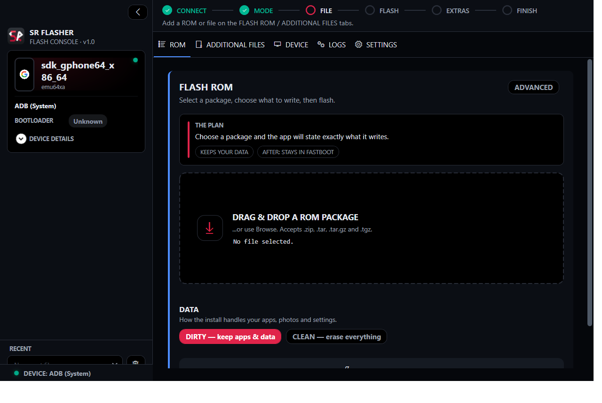
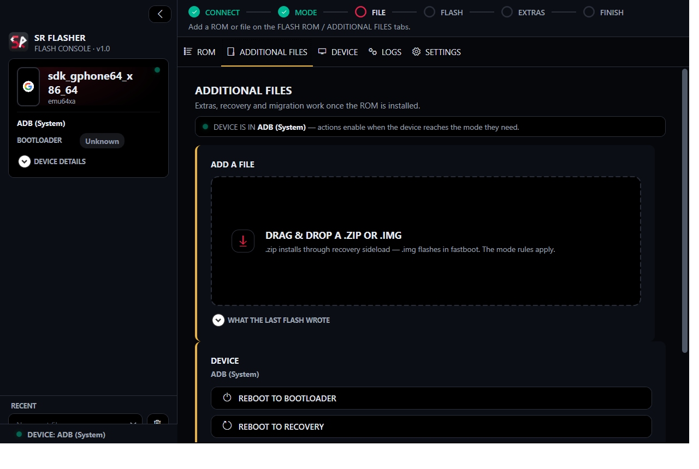
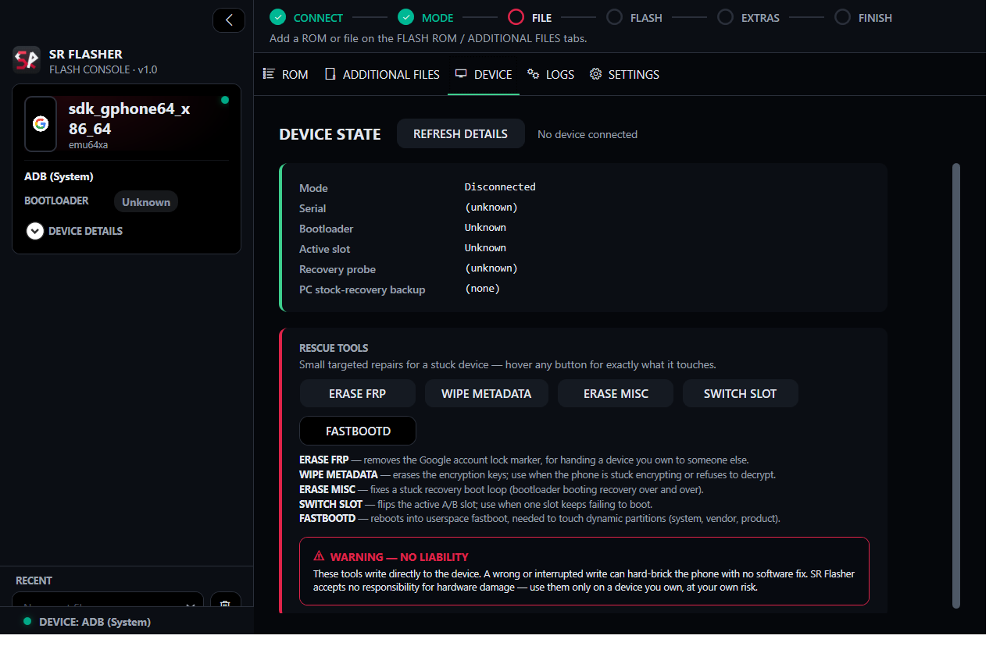
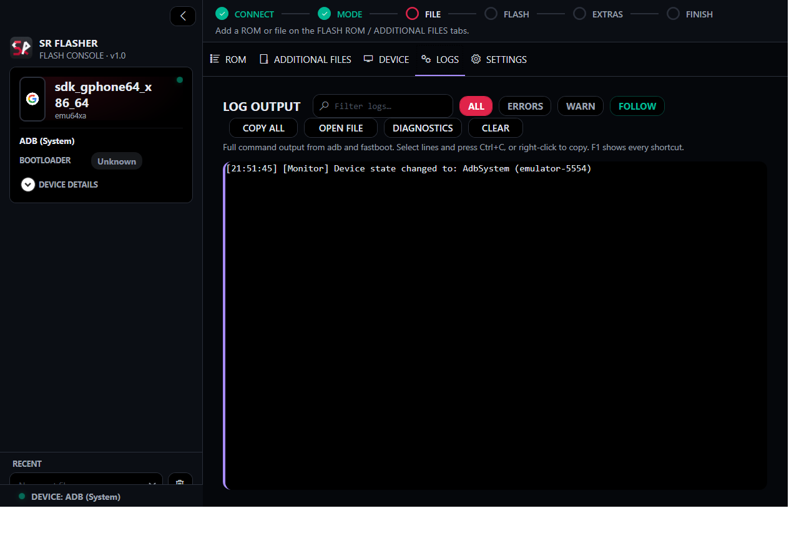
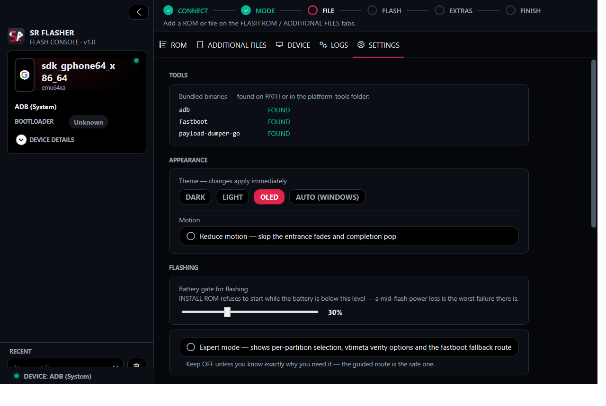

# SR Flasher — Flash Console

<p align="center">
  <picture>
    <source media="(prefers-color-scheme: dark)" srcset="SRFlasher/Assets/flasher-logo-on-dark-256.png"/>
    <source media="(prefers-color-scheme: light)" srcset="SRFlasher/Assets/flasher-logo-on-light-256.png"/>
    
  </picture>
</p>

A fastboot/adb flashing console for **A/B Android devices** — payload installs, custom recovery, guided sideload and rescue tools, wrapped in a focused WPF desktop app.

> ⚠️ **READ FIRST — RISK**
> Flashing modifies your device's partitions. Unlocking the bootloader **wipes the device**, and a bad flash can **hard-brick** it (sometimes irrecoverably).
> SR Flasher runs every command locally through adb/fastboot and tells you exactly what it will write before it writes it — but **you** choose what to flash. **No warranties. You accept the risk.**

---

## Why SR Flasher

- **One contract, shown up front.** Before any flash, *THE PLAN* states exactly what will be written, how the install handles your data, and what happens after.
- **Full payload support.** Modern OTA `payload.bin` packages are extracted with [payload-dumper-go](https://github.com/ssut/payload-dumper-go) and flashed partition-by-partition — with image verification, wipe options and vbmeta verity controls.
- **A/B aware.** Dual-slot devices are detected and handled; custom recovery (OrangeFox / TWRP) can be written to both slots, with a pre-repair backup of the active recovery partition kept before any repair.
- **Guided sideload.** The app walks the two-stage ROM install: write the boot chain → reboot to recovery → the ROM applies itself via sideload → extras (GAPPS, Magisk…) on the ADDITIONAL FILES tab → first boot.
- **One-press chains.** Reboots between modes are chained automatically; progress stays on screen through the whole session, including the reboot stretches.
- **Rescue tools.** A plain-language toolkit for the bad days — with honest labeling of what cannot be fixed (EDL 9008 needs an authorized flasher).
- **Runs everything locally.** No accounts, no uploads, no telemetry. Logs and backups live under your user profile (`%APPDATA%\SRFlasher`, `Documents\SRFlasher`).

## How it compares

### vs flashing manually with fastboot/adb

A manual flash means memorizing partition tables and `_a`/`_b` slot suffixes, extracting `payload.bin` yourself, getting wipe and vbmeta flags right, and driving the phone through bootloader → recovery → sideload in exactly the right order at the right moments. One wrong slot, one stale image, one forgotten `--disable-verity` — and you are bootlooping with no record of what you actually ran.

SR Flasher replaces that choreography:

| | Manual fastboot | SR Flasher |
|---|---|---|
| What gets written | whatever you type, when you type it | a stated plan *before* the flash, then exactly that |
| `payload.bin` | extract with scripts by hand | built-in extraction with per-partition progress |
| A/B slots | you track `_a`/`_b` yourself | detected automatically; both-slot recovery writes with a pre-repair backup |
| Reboot chains | manual reboots, timed by you | mode changes chained for you, with retry-while-unauthorized |
| When something fails | cryptic `fastboot` output to decode | failures translated to plain language; disabled buttons *say why* |
| Record of the session | your terminal scrollback | a full command journal in the LOGS tab, plus a copyable flash report |
| Setup | install platform-tools, keep them updated | portable zip — adb, fastboot and payload-dumper-go bundled |

The payoff: the risky part stays manual — *deciding what to flash* — while the error-prone part (command sequencing, slot tracking, mode timing) is automated.

### vs other flashing tools

- **No hidden steps.** Many flashers are wizards that abstract the device away; SR Flasher shows the exact commands it runs, in real time, so nothing is a black box.
- **Progress that survives reboots.** Most tools' progress bars die the moment the device leaves fastboot. Here the whole two-stage install — including the recovery/sideload stretches — stays on screen under one progress contract.
- **Honest about limits.** Where a device can't be helped (EDL 9008, unsupported `fastboot fetch`), the app says so plainly and takes the safe alternative (e.g. in-recovery `dd` readback verification) instead of pretending.
- **Repair with a safety net.** When a custom recovery doesn't stick, the repair path backs up the current recovery partition first — you're never one bad write away from no recovery at all.
- **Small and auditable.** A focused codebase with a 59-test regression suite, no installer, no background services, no telemetry — clone it, read it, build it.

## Features

| Area | What it does |
|---|---|
| FLASH ROM | payload packages, loose image sets, clean/dirty flash choice, vbmeta disable-verity, per-partition selection (advanced mode) |
| POST-FLASH | recovery install (zip sideload or fastboot image, A/B both-slot), boot/vendor_boot patches, Magisk-ready boot extraction |
| DEVICE | live dashboard: mode, slot, bootloader state, battery, anti-rollback version, per-device PC backup inventory |
| RESCUE TOOLS | boot-repair essentials with plain-language guidance and hard-brick honesty |
| LOGS | full command output, level filters, diagnostics bundle for support |
| SETTINGS | Dark / Light / OLED / Auto themes, reduce-motion toggle, expert mode |

**Easy Flow step trail** — `CONNECT · MODE · FILE · FLASH · EXTRAS · FINISH` — tracks where you are in the session at a glance.

## Requirements

- Windows 10 or 11 (x64)
- [.NET Framework 4.8](https://dotnet.microsoft.com/download/dotnet-framework/net48) (built into Windows 10/11)
- An **unlocked bootloader** device with USB debugging enabled
- No admin rights needed; nothing installs system-wide

## Getting SR Flasher

**Option A — portable (recommended):** grab `SRFlasher_v1.0_Portable.zip` from the [Releases](../../releases) page, unzip anywhere, run `SRFlasher.exe`. `adb`, `fastboot` and `payload-dumper-go` are bundled — no SDK needed.

**Option B — build it yourself:**

```bat
git clone https://github.com/sreejith19931/SRFlasher.git
cd SRFlasher
:: restore the (small) NuGet dependencies, then build + run the 59 tests
msbuild SRFlasher.slnx -t:Restore -p:RestorePackagesConfig=true
msbuild SRFlasher.slnx -p:Configuration=Debug
SRFlasher.Tests\bin\Debug\SRFlasher.Tests.exe
```

A **Release** build also produces the portable zip automatically at `SRFlasher\bin\Release\Dist\SRFlasher_v1.0_Portable.zip`.

## How it works

SR Flasher drives the standard Android tooling — `adb` and `fastboot` — plus `payload-dumper-go` for OTA payloads. Every operation's exact command line is written to the LOGS tab, so you can audit (or reproduce) each step. Device state is polled continuously; the UI only enables the actions the current mode can perform, and mode switches are chained for you with retry-on-unauthorized handling.

Backups taken before risky operations (e.g. recovery-partition repair) are kept per device serial under `Documents\SRFlasher\Backups\<serial>\`.

## Known limits

- `fastboot fetch` is unsupported on some devices (verified on POCO F7 / `onyx`); write verification for those devices falls back to an in-recovery `dd` readback check.
- EDL (Qualcomm 9008) devices are **not** flashable from SR Flasher — that state requires an authorized EDL flasher. The app tells you so plainly.
- Windows only (WPF / .NET Framework 4.8).

## Screenshots

<p align="center">
  
</p>
<p align="center">
  
  
</p>
<p align="center">
  
  
</p>

## License

[MIT](LICENSE) — see also [THIRD-PARTY-NOTICES.md](THIRD-PARTY-NOTICES.md) for bundled tooling (Android platform-tools, payload-dumper-go, Serilog). Device vendor logos are used solely to identify devices; all trademarks belong to their respective owners.
